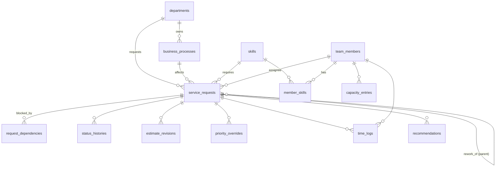
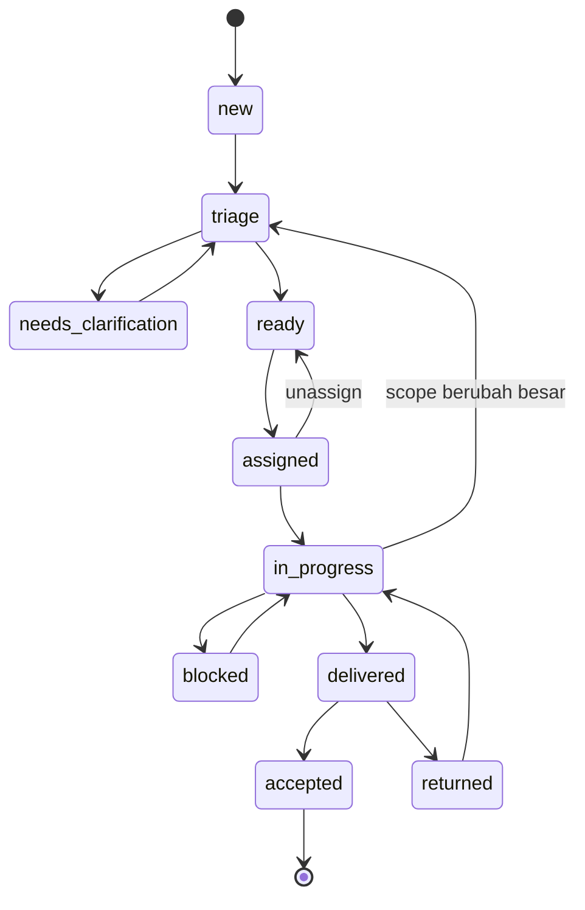

# Technical Blueprint — Intelligent Service Operations & Capacity Planning (ServOps)

> Dokumen acuan teknis untuk membangun prototipe. Berisi keputusan stack, arsitektur, skema database,
> aturan bisnis (prioritas, kapasitas, SLA, workflow), mesin rekomendasi, skenario simulasi, dan rencana implementasi.
> Semua angka/bobot adalah **default yang dapat dikonfigurasi** di `config/servops.php`.

---

## 0. Ringkasan Keputusan Teknis

| Aspek | Keputusan | Alasan |
|---|---|---|
| Framework | **Laravel 13.x** (terbaru, PHP ≥ 8.3; lokal PHP 8.4.12) | Ekosistem lengkap: Eloquent, scheduler, queue, validation, testing |
| Database | **MySQL 9.4** lokal, `127.0.0.1:3306`, DB **`vibecoding`** | Sesuai lingkungan lokal |
| UI | **Blade + Livewire + Tailwind CSS + Alpine.js**, chart pakai **Chart.js** | Interaktif tanpa SPA terpisah; cepat untuk prototipe |
| Logika domain | **Service layer** di `app/Services/*` (engine murni, mudah di-unit-test) | Rekomendasi harus bisa dijelaskan & dites, tidak tersebar di controller |
| Status & enum | **PHP backed enums** + `TransitionService` (state machine eksplisit) | Mencegah status ilegal (mis. Done tanpa acceptance) |
| Perhitungan metrik | Disimpan ter-denormalisasi di `service_requests` (skor, risiko, alasan), dihitung ulang via event + scheduler | Dashboard cepat; alasan tersimpan & dapat diaudit |
| Waktu | **Working-hours calendar** + **simulation clock** | SLA dihitung dalam jam kerja; demo skenario butuh "waktu" yang bisa digeser |
| Queue | `QUEUE_CONNECTION=sync` (prototipe) | Tanpa worker terpisah; bisa diganti `database` nanti |
| Auth | **Login (session) + RBAC**: 4 peran → permission (`ActorRole::permissions()`), `ServiceRequestPolicy` untuk kepemilikan (assignee / departemen pemohon) | Kontrol akses nyata; audit log mencatat user yang login. *(Awalnya "acting as"; diganti atas permintaan.)* |
| Testing | PHPUnit (bawaan) — unit test engine + feature test workflow | Data SR-101..107 dijadikan acceptance test |

---

## 1. Setup Proyek

```bash
cd ~/Desktop/vibecode_assesment
composer create-project laravel/laravel servops      # Laravel 13.x
cd servops

# Buat database (isi password root MySQL)
mysql -uroot -p -e "CREATE DATABASE IF NOT EXISTS vibecoding CHARACTER SET utf8mb4 COLLATE utf8mb4_unicode_ci;"

composer require livewire/livewire
npm install && npm install chart.js
```

`.env` (Laravel 13 default ke SQLite — **wajib diganti**):

```dotenv
APP_NAME="ServOps"
APP_TIMEZONE=Asia/Jakarta

DB_CONNECTION=mysql
DB_HOST=127.0.0.1
DB_PORT=3306
DB_DATABASE=vibecoding
DB_USERNAME=root
DB_PASSWORD=<password_mysql_lokal>

SESSION_DRIVER=database
CACHE_STORE=database
QUEUE_CONNECTION=sync

# Opsional: kunci "waktu sekarang" untuk demo (ISO 8601). Kosong = waktu nyata.
SERVOPS_NOW=
```

```bash
php artisan migrate:fresh --seed
composer run dev        # serve + vite
```

---

## 2. Arsitektur

```
┌──────────────────────────────────────────────────────────────────────┐
│ UI: Blade + Livewire (Dashboard, Requests, Team, Risk, Simulation)   │
└───────────────┬──────────────────────────────────────────────────────┘
                │ actions (assign, transition, revise estimate, override)
┌───────────────▼──────────────────────────────────────────────────────┐
│ Application: Controllers / Livewire components (tipis, validasi)     │
└───────────────┬──────────────────────────────────────────────────────┘
┌───────────────▼──────────────────────────────────────────────────────┐
│ Domain Services                                                      │
│  WorkflowTransitionService  ── guards + history                      │
│  PriorityEngine             ── skor + breakdown + human-review flags │
│  CapacityService            ── jam tersedia per orang/skill          │
│  AssignmentRecommender      ── filter kompetensi + ranking           │
│  SlaRiskEngine              ── slack, projected finish, risk reasons │
│  EstimateAdvisor            ── median/P80 historis, buang outlier    │
│  RecommendationEngine       ── tindakan yang disarankan              │
│  ImpactPreviewService       ── dry-run "what-if" (insert urgent)     │
│  ScenarioService            ── simulasi skenario perubahan           │
│  WorkingCalendar / Clock    ── jam kerja, libur, waktu simulasi      │
└───────────────┬──────────────────────────────────────────────────────┘
┌───────────────▼──────────────────────────────────────────────────────┐
│ Persistence: Eloquent Models + MySQL `vibecoding`                    │
│ Service workflow → MetricsRecomputer::run() setelah tiap perubahan   │
│ Scheduler: servops:recompute (tiap 15 menit), servops:snapshot (harian)│
└──────────────────────────────────────────────────────────────────────┘
```

**Alur recompute:** setiap operasi `WorkflowTransitionService` / `RequestChangeService` / `RecommendationService`
memanggil `MetricsRecomputer` → `PriorityEngine` → `SlaRiskEngine` (butuh urutan prioritas per assignee) → `RecommendationEngine`.
Juga dipanggil oleh `servops:recompute` (scheduler, tiap 15 menit — waktu berjalan mengubah slack) dan di akhir seeder.
Recompute dijalankan **untuk seluruh backlog aktif** (data kecil; antrean per orang saling memengaruhi).

> *Implementasi:* awalnya direncanakan via Observers + Job. Diganti pemanggilan eksplisit dari service agar tidak ada
> loop recompute (recompute sendiri menyimpan model) dan hasil deterministik. Toggle: `SERVOPS_AUTO_RECOMPUTE`.

### Struktur folder

```
app/
  Enums/            RequestStatus, RiskLevel, ImpactLevel, RequesterPriority,
                    EstimateConfidence, DependencyType, CapacityEntryType,
                    RecommendationType, ActorRole
  Models/           ServiceRequest, TeamMember, Skill, MemberSkill, Department,
                    BusinessProcess, RequestDependency, CapacityEntry, StatusHistory,
                    EstimateRevision, PriorityOverride, TimeLog, Holiday,
                    Recommendation, KpiSnapshot, ScenarioRun
  Services/
    Calendar/       Clock.php, WorkingCalendar.php
    Workflow/       WorkflowTransitionService.php, TransitionGuard.php
    Priority/       PriorityEngine.php
    Capacity/       CapacityService.php
    Assignment/     AssignmentRecommender.php
    Risk/           SlaRiskEngine.php
    Estimation/     EstimateAdvisor.php
    Recommendation/ RecommendationEngine.php, ImpactPreviewService.php
    Simulation/     ScenarioService.php
  Data/             PriorityResult, RiskResult, AssignmentCandidate, Reason (DTO readonly)
  Services/Metrics/ MetricsRecomputer.php (orkestrator)
  Livewire/         Dashboard, RequestBoard, RequestDetail, TeamCapacity,
                    RiskMonitor, RecommendationPanel, SimulationPanel
  Console/Commands/ RecomputeCommand.php, SnapshotCommand.php
config/servops.php
database/migrations, database/seeders
tests/Unit/Services/*, tests/Feature/*
```

---

## 3. Model Data

### 3.1 ERD



### 3.2 Tabel

**`departments`** — `id, name, code`

**`business_processes`** — `id, department_id, name, criticality (1–5), used_by_departments_count`
> Dasar penilaian dampak; mendukung skenario "prioritas rendah ternyata berdampak ke proses penting".

**`skills`** — `id, code (data_analysis, reporting, troubleshooting, automation, process_analysis, admin), name`

**`team_members`**
| kolom | tipe | catatan |
|---|---|---|
| id, name, role_title | | |
| seniority | enum junior/mid/senior | |
| daily_hours | decimal(4,2) | default 8 |
| focus_factor | decimal(3,2) | default 0.75 (interupsi, context switch) |
| routine_hours_per_day | decimal(4,2) | rutin harian |
| meeting_hours_per_day | decimal(4,2) | rapat rutin |
| wip_limit | tinyint | default 3 |
| is_active | bool | |

**`member_skills`** — `member_id, skill_id, level (1=basic, 2=independent, 3=expert)`, unique(member_id, skill_id)

**`service_requests`** (tabel inti)
| kolom | tipe | catatan |
|---|---|---|
| id, code | string unique | `SR-101` |
| title, description | | |
| category | string | analysis / incident / automation / rework / reporting / change / investigation |
| requester_department_id | FK | |
| business_process_id | FK nullable | |
| requester_priority | enum low/medium/high | **sinyal saja**, bobot kecil |
| impact_level | enum unknown/low/medium/high/critical | `unknown` → wajib triage |
| affected_users | int nullable | |
| affected_departments | int nullable | |
| required_skill_id | FK nullable | |
| required_level | tinyint | default 2 |
| estimate_hours | decimal nullable | `null` = belum diketahui |
| estimate_confidence | enum low/medium/high | |
| remaining_hours | decimal nullable | sisa effort aktif |
| actual_hours | decimal default 0 | dari `time_logs` |
| deadline_at | datetime | |
| status | enum `RequestStatus` | lihat §4 |
| assignee_id | FK nullable | |
| parent_request_id | FK nullable | **rework** menunjuk request asal |
| rework_count | int default 0 | |
| rework_cause | enum nullable | `quality` / `requirement_change` / `unclear_scope` |
| blocked_since | datetime nullable | |
| wait_hours_total | decimal default 0 | jam kerja dalam status menunggu |
| started_at, delivered_at, accepted_at | datetime nullable | |
| **priority_score** | decimal(5,2) | hasil `PriorityEngine` |
| **priority_breakdown** | json | kontribusi per faktor |
| **priority_rank** | int | urutan global |
| **needs_human_review** | bool | |
| **review_reasons** | json | kode + teks |
| **risk_level** | enum `RiskLevel` | |
| **risk_reasons** | json | kode + teks + tindakan |
| **slack_hours** | decimal nullable | |
| **latest_start_at** | datetime nullable | |
| **projected_finish_at** | datetime nullable | |
| metrics_computed_at | datetime | |
| timestamps, soft deletes | | |

Index: `(status)`, `(assignee_id, status)`, `(deadline_at)`, `(risk_level)`.

**`request_dependencies`**
| kolom | catatan |
|---|---|
| request_id | yang menunggu |
| depends_on_request_id | nullable — dependensi internal |
| type | `internal` / `external` |
| external_party | mis. "Tim Finance" (untuk external) |
| description | "Data penjualan Q3" |
| expected_at | ETA yang dijanjikan |
| resolved_at | nullable |

**`capacity_entries`** — `member_id, type (leave/sick/meeting/training/other), starts_at, ends_at, hours nullable, note`
> Skenario "anggota tiba-tiba tidak tersedia" = insert `sick` → recompute.

**`time_logs`** — `request_id, member_id, started_at, ended_at, hours, kind (work/rework)`
> Basis waktu aktif aktual & akurasi estimasi.

**`status_histories`** — `request_id, from_status, to_status, actor_role, actor_name, reason, meta json, created_at`

**`estimate_revisions`** — `request_id, old_hours, new_hours, delta_pct, reason, scope_change bool, actor_*, created_at`

**`priority_overrides`** — `request_id, old_rank, forced_rank / pinned bool, reason (wajib), approved_by, expires_at nullable, created_at`

**`holidays`** — `date, name`

**`recommendations`** — `request_id nullable, member_id nullable, type, severity, title, rationale, payload json, status (open/accepted/dismissed), decided_by, decided_at, fingerprint unique`
> `fingerprint` = hash(type + target) agar rekomendasi tidak duplikat tiap recompute.

**`kpi_snapshots`** — `date, metrics json` (tren harian untuk dashboard)

**`scenario_runs`** — `scenario, params json, before json, after json, created_at` (bukti before/after untuk demo)

---

## 4. Workflow & Status

### 4.1 Enum `RequestStatus`

| Status | Arti | Dihitung sebagai beban? |
|---|---|---|
| `new` | Baru masuk | tidak |
| `triage` | Dinilai: dampak, skill, estimasi | tidak |
| `needs_clarification` | Scope/kebutuhan belum jelas | tidak (flag risiko) |
| `ready` | Siap dikerjakan, belum ditugaskan | ya (backlog) |
| `assigned` | Ditugaskan, belum mulai | ya |
| `in_progress` | Dikerjakan | ya |
| `blocked` | Menunggu dependensi | ya (beban tertahan) |
| `delivered` | Diserahkan, **menunggu acceptance** pemohon | ya (belum selesai!) |
| `returned` | Dikembalikan untuk revisi | ya + rework |
| `accepted` | Diterima — **satu-satunya status "selesai"** | tidak |
| `cancelled` | Dibatalkan | tidak |

> **Keputusan kunci:** "Done" dipecah menjadi `delivered` → `accepted`/`returned`. Dashboard hanya menghitung `accepted`
> sebagai selesai, sehingga skenario "dikembalikan tetapi tetap terhitung selesai" tidak mungkin terjadi.

### 4.2 Diagram


`cancelled` dapat dicapai dari status mana pun kecuali `accepted` (alasan wajib).

### 4.3 Guard Transisi

| Transisi | Guard (ditolak jika tidak terpenuhi) | Efek samping |
|---|---|---|
| triage → ready | `estimate_hours` terisi, `required_skill_id` terisi | `remaining_hours = estimate_hours`; jika `impact_level = unknown` → `needs_human_review` |
| triage → needs_clarification | alasan wajib | flag risiko `SCOPE_UNCLEAR` |
| ready → assigned | assignee aktif **dan** level skill ≥ `required_level`, **atau** override dengan alasan + `pairing_with` | rekomendasi PAIRING bila under-skilled |
| assigned → in_progress | tidak ada dependensi `resolved_at = null`; WIP assignee < limit (soft warning) | `started_at` |
| in_progress → blocked | alasan / dependensi wajib | `blocked_since = now` |
| blocked → in_progress | semua dependensi resolved | tambahkan durasi ke `wait_hours_total` |
| in_progress → delivered | — | `delivered_at` |
| delivered → returned | alasan wajib + `rework_estimate_hours` wajib | `rework_count++`, `remaining_hours = rework_estimate`, `estimate_revisions` dicatat dengan kind rework |
| delivered → accepted | aktor = Requester/Manager | `accepted_at`; masuk data historis durasi |
| in_progress → triage | `estimate_revisions.scope_change = true` | status kembali dinilai |

Implementasi: `RequestStatus::allowedTransitions(): array` + `WorkflowTransitionService::transition($request, $to, $actor, $reason, $payload)`
di dalam `DB::transaction`, menulis `status_histories`, melempar `InvalidTransitionException` dengan pesan yang bisa ditampilkan.

### 4.4 Aturan Perubahan

- **Revisi estimasi**: wajib alasan, tercatat di `estimate_revisions`. Kenaikan > **30%** → `needs_human_review` + risk reason `ESTIMATE_GROWTH`.
- **Override prioritas** (manajemen): wajib alasan; sistem menampilkan **ImpactPreview** (task mana yang bergeser/terlambat) sebelum disimpan.
- **Rework** bukan request baru yang lepas — tetap request asal yang `returned`, **atau** (jika dari periode lalu) request baru dengan `parent_request_id`. Keduanya terhitung di metrik rework.
- **Semua perubahan** dapat ditelusuri dari `status_histories`, `estimate_revisions`, `priority_overrides`.

---

## 5. Working Calendar & Clock

- `Clock::now()` → `SERVOPS_NOW` / cache `servops.sim_now` jika diset, selain itu `now()`. **Semua engine wajib memakai `Clock`**, bukan `now()` langsung.
- `WorkingCalendar`: jam kerja 08:00–17:00 Senin–Jumat, istirahat 12:00–13:00 (8 jam), dikurangi `holidays`.
  - `workingHoursBetween(Carbon $a, Carbon $b): float`
  - `addWorkingHours(Carbon $from, float $hours): Carbon`
- "Tenggat 2 hari" pada data awal → di-seed sebagai akhir jam kerja H+2.

---

## 6. PriorityEngine

### 6.1 Formula

```
Score (0–100) = Σ wᵢ · Fᵢ
```

| Faktor | Bobot default | Cara hitung Fᵢ (0–100) |
|---|---|---|
| **Impact** | 0.35 | base: critical 100, high 75, medium 50, low 25, **unknown 50** (tidak diasumsikan rendah) + `min(20, 5 × affected_departments)` + `5 × (process.criticality − 3)`, clamp 0–100 |
| **Urgency** | 0.25 | `max(tekanan, kedekatan)`. Tekanan = `jam_dibutuhkan / (jam_kerja_tersisa × 0.6)` × 100 (0.6 = rasio jam efektif tim). Kedekatan = `100 × (1 − min(1, jam_kerja_tersisa / 40))`. Lewat tenggat → 100. *Kedekatan ditambahkan saat implementasi: tanpa itu insiden 2 jam bertenggat hari ini hanya mendapat urgensi ±25.* |
| **Dependency (blocking)** | 0.15 | `min(100, 40 × jumlah request aktif yang menunggu request ini)` |
| **Requester priority** | 0.10 | high 100, medium 60, low 30 |
| **Scarce skill lead time** | 0.10 | jumlah anggota qualified: 1 → 100, 2 → 60, ≥3 → 20 |
| **Age** | 0.05 | `min(100, 10 × hari kerja menunggu)` |

- Jika `estimate_hours` null → Urgency memakai **P80 historis kategori** (dari `EstimateAdvisor`) + review reason `ESTIMATE_UNKNOWN`.
- **Pinned override** dari manajemen menempatkan request di atas ranking hitungan, tetapi skor asli tetap ditampilkan.
- Tie-breaker: deadline lebih awal → impact lebih tinggi → created_at.

### 6.2 Output (`PriorityResult`)

```json
{
  "score": 78.4,
  "breakdown": [
    {"factor": "impact", "raw": 85, "weight": 0.35, "contribution": 29.75, "note": "Dampak ke 3 departemen, proses kritis"},
    {"factor": "urgency", "raw": 100, "weight": 0.25, "contribution": 25.0, "note": "Butuh 2 jam, sisa 3 jam kerja"},
    ...
  ],
  "needs_human_review": true,
  "review_reasons": [{"code": "IMPACT_UNKNOWN", "text": "Dampak belum diidentifikasi — lakukan triage"}]
}
```
UI menampilkan breakdown sebagai bar bertumpuk + kalimat penjelasan, sehingga rekomendasi **dapat dijelaskan**.

### 6.3 Pemicu Review Manusia

| Kode | Kondisi |
|---|---|
| `IMPACT_UNKNOWN` | `impact_level = unknown` |
| `ESTIMATE_UNKNOWN` | `estimate_hours` null |
| `CLOSE_CALL` | selisih skor dengan peringkat berdekatan < 3 poin **dan** keduanya bersaing untuk assignee/skill yang sama |
| `OVERRIDE_ACTIVE` | ada `priority_overrides` aktif |
| `UNDERQUALIFIED_ASSIGNMENT` | assignee di bawah `required_level` |
| `ESTIMATE_GROWTH` | estimasi naik > 30% |
| `CROSS_DEPT_CONFLICT` | ≥2 request dari departemen berbeda terlambat bila hanya satu yang didahulukan |

---

## 7. CapacityService

```
effective_daily(m, d)  = daily_hours × focus_factor − routine − meeting − capacity_entries(m, d)
committed(m)           = Σ remaining_hours request aktif milik m (assigned, in_progress, blocked, returned, delivered*0)
available(m, horizon)  = Σ effective_daily(m, d) untuk d dalam horizon − committed(m)
utilization(m, horizon)= committed(m) / Σ effective_daily(m, d)
```

- Horizon default: **5 hari kerja**.
- **Skill supply vs demand** (deteksi bottleneck):
  - `supply(skill) = Σ available(m)` untuk m dengan level ≥ 2
  - `demand(skill) = Σ remaining_hours` request aktif + ready yang membutuhkan skill tersebut
  - `demand/supply > 1.0` → bottleneck, `> 0.8` → peringatan
- Ambang: overload `utilization > 1.0`, idle `< 0.6`.

---

## 8. AssignmentRecommender

1. **Filter keras** (wajib lolos):
   - `is_active` dan tidak ada `capacity_entries` cuti/sakit yang menutupi window kerja yang dibutuhkan
   - `member_skills.level ≥ required_level`
2. **Ranking** kandidat yang lolos:
   ```
   fit = 0.45 · capacity_fit      (available ≥ remaining → 100, proporsional jika kurang)
       + 0.25 · finish_before_deadline (projected finish di antrean m ≤ deadline → 100)
       + 0.15 · skill_match       (level tepat sama dengan syarat → 100; overqualified → 70, agar expert tidak dihabiskan)
       + 0.15 · context           (assignee request asal untuk rework → 100)
   ```
3. **Jika tidak ada kandidat yang lolos**:
   - Tampilkan kandidat under-skilled berkapasitas sebagai **opsi PAIRING** (wajib mentor qualified + alasan) — **tidak pernah otomatis**.
   - Hasilkan rekomendasi `NEGOTIATE_DEADLINE` / `SPLIT_SCOPE` / `ADD_CAPACITY`.
4. Output `AssignmentCandidate[]`: `member, fit, projected_finish_at, reasons[], warnings[]`.

---

## 9. SlaRiskEngine

### 9.1 Besaran yang Dibedakan

| Besaran | Definisi |
|---|---|
| Deadline | `deadline_at` (komitmen ke pemohon) |
| Estimasi | `estimate_hours` (effort total, bisa direvisi) |
| Sisa effort | `remaining_hours` |
| Waktu aktif | Σ `time_logs` / durasi status `in_progress` |
| Waktu tunggu | Σ durasi status `ready`, `assigned`, `blocked`, `delivered`, `returned` (jam kerja) |
| Lead time | created → accepted |

### 9.2 Perhitungan

```
hours_left       = WorkingCalendar.workingHoursBetween(Clock.now, deadline_at)
slack_hours      = hours_left − remaining_hours
latest_start_at  = deadline_at mundur remaining_hours jam kerja (dengan kapasitas efektif assignee)
queue_ahead(m)   = Σ remaining_hours request milik m dengan rank lebih tinggi
projected_finish = addWorkingHours(now, (queue_ahead + remaining) / focus-adjusted rate m)
                   (blocked: mulai dari max(now, dependency.expected_at))
                   (unassigned: pakai kandidat terbaik dari AssignmentRecommender)
```

> Memakai **projected finish berbasis antrean**, bukan hanya slack — inilah yang membuat risiko terlihat
> sebelum tenggat, meskipun status masih "normal".

### 9.3 Level Risiko

| Level | Kondisi |
|---|---|
| 🟢 `on_track` | `projected_finish ≤ deadline − buffer` (buffer = max(2 jam, 20% remaining)) |
| 🟡 `at_risk` | `projected_finish` di antara `deadline − buffer` dan `deadline`, **atau** ada trigger tambahan |
| 🔴 `will_breach` | `projected_finish > deadline` |
| ⚫ `breached` | `now > deadline` dan belum `accepted` |

### 9.4 Risk Reasons → Tindakan

| Kode | Trigger | Tindakan disarankan |
|---|---|---|
| `QUEUE_OVERLOAD` | antrean assignee membuat projected > deadline | Reassign / rebalance |
| `BLOCKED_NEAR_LATEST_START` | `blocked` dan `now ≥ latest_start − 4 jam` | Eskalasi ke pihak dependensi; negosiasi tenggat |
| `EXTERNAL_ETA_LATE` | `dependency.expected_at > latest_start_at` | Eskalasi sekarang; siapkan pekerjaan parsial |
| `UNASSIGNED_LOW_SLACK` | belum ditugaskan dan `slack < 8 jam` | Tugaskan segera (kandidat terlampir) |
| `ASSIGNEE_UNAVAILABLE` | `capacity_entries` assignee menutupi window kerja | Reassign ke kandidat qualified |
| `SCOPE_UNCLEAR` | `needs_clarification` / estimasi null | Sesi klarifikasi ber-timebox |
| `ESTIMATE_GROWTH` | kenaikan estimasi > 30% | Re-baseline tenggat / split scope |
| `REWORK` | `rework_count ≥ 1` | Review kualitas / kriteria acceptance |
| `SCARCE_SKILL` | hanya 1 orang qualified **dan** bebannya (committed + pekerjaan ini) ≥ 60% kapasitasnya sampai tenggat | Mulai lebih awal; cross-training |

---

## 10. EstimateAdvisor (data historis)

- Sumber: request `accepted` (seed ± 40 data historis per kategori, termasuk beberapa **outlier ekstrem**).
- Buang outlier dengan **IQR** (di luar `Q1 − 1.5·IQR` .. `Q3 + 1.5·IQR`).
- Tampilkan **median** (estimasi tipikal) dan **P80** (untuk perencanaan konservatif), plus `n` dan jumlah outlier yang dibuang.
- Akurasi estimasi per request = `actual_hours / estimate_hours`; agregat per kategori & per orang.
- **Tidak memakai rata-rata** sebagai default karena mudah terdistorsi outlier.

---

## 11. RecommendationEngine

Dijalankan setelah recompute; menghasilkan `recommendations` (unik per `fingerprint`), dapat **accept** / **dismiss** (tercatat siapa dan kapan).

| Tipe | Kondisi | Payload / Aksi saat Accept |
|---|---|---|
| `REASSIGN` | (a) request `ready` tanpa assignee → "Tugaskan ke X" (kandidat terbaik; severity naik bila slack rendah / skill langka); (b) `ASSIGNEE_UNAVAILABLE` / `QUEUE_OVERLOAD` dan ada kandidat qualified yang selesai tepat waktu | assign / ganti assignee lewat workflow |
| `REBALANCE` | member util > 1.1 dan member lain < 0.6 dengan skill overlap | pindahkan request ber-rank terendah |
| `ESCALATE_DEPENDENCY` | `BLOCKED_NEAR_LATEST_START` / `EXTERNAL_ETA_LATE` | catat eskalasi (activity) |
| `CLARIFY_SCOPE` | `needs_clarification` & deadline < 2 hari kerja | buat task klarifikasi 2 jam |
| `TRIAGE_IMPACT` | `impact_level = unknown` | buka form triage dampak |
| `START_EARLY` | `SCARCE_SKILL` | pindahkan ke atas antrean specialist |
| `PAIRING` | tidak ada kandidat qualified berkapasitas | assign under-skilled + mentor |
| `NEGOTIATE_DEADLINE` / `SPLIT_SCOPE` | `will_breach` tanpa opsi reassign | catat keputusan |
| `ADD_CAPACITY` / `CROSS_TRAIN` | `demand/supply(skill) > 1.0` | informasi ke manajemen |

### ImpactPreviewService (insert urgent tanpa tambah kapasitas)

`preview(Closure $mutation)` → jalankan perubahan + seluruh engine **di dalam transaksi DB lalu rollback** (tanpa efek samping, hasil identik dengan engine sungguhan) → kembalikan:
```
[{code: "SR-101", before: on_track, after: will_breach, delta_finish: +6h}, ...]
```
Manajemen melihat **harga dari keputusan** sebelum menyimpan override.

---

## 12. Dashboard (Decision Support) — Definisi Indikator

| Indikator | Formula | Pertanyaan yang dijawab |
|---|---|---|
| Backlog aktif | count status ∈ {ready … returned} | Berapa beban? |
| **Selesai (benar)** | count `accepted` dalam periode | Berapa yang benar-benar selesai? |
| At risk / will breach | count per `risk_level` + daftar dengan alasan | Apa yang akan telat & kenapa? |
| Utilisasi per orang | `committed / effective capacity` (horizon 5 hari) | Siapa overload / idle? |
| Skill demand vs supply | §7 | Di mana bottleneck kompetensi? |
| Blocked hours by party | Σ jam blocked per `external_party` / internal | Siapa sumber hambatan? |
| Flow efficiency | `active_hours / lead_time_hours` | Seberapa banyak waktu terbuang menunggu? |
| Rework rate | `request dengan rework_count ≥ 1 / delivered` | Kualitas & kejelasan kebutuhan? |
| Rework hours | Σ effort rework | Beban tersembunyi dari revisi |
| Estimate accuracy | median `actual / estimate` per kategori | Estimasi bisa dipercaya? |
| Late cause breakdown | distribusi `risk_reasons.code` untuk request at-risk/breached | **Mengapa** pekerjaan terlambat |
| Rekomendasi terbuka | list `recommendations` open by severity | **Apa** yang harus dilakukan |

Layout: KPI row → "Needs attention" (at risk + alasan + tombol aksi) → kapasitas tim (bar utilisasi) →
bottleneck skill → penyebab keterlambatan (bar) → tren (`kpi_snapshots`).

---

## 13. Halaman & Route

| Route | Komponen | Fungsi |
|---|---|---|
| `GET /` | `Dashboard` | §12 |
| `GET /requests` | `RequestBoard` | tabel urut `priority_rank`, filter status/risk/skill, tampilan kanban opsional |
| `GET /requests/create` | form | input request baru (impact boleh `unknown`) |
| `GET /requests/{code}` | `RequestDetail` | breakdown skor, risiko & alasan, kandidat assignee, dependensi, timeline history, revisi estimasi |
| `POST /requests/{code}/transition` | | `WorkflowTransitionService` |
| `POST /requests/{code}/assign` | | via guard kompetensi |
| `POST /requests/{code}/estimate` | | revisi estimasi + alasan |
| `POST /requests/{code}/override` | | override prioritas + ImpactPreview |
| `POST /requests/{code}/dependencies` | | tambah/resolve dependensi |
| `GET /team` | `TeamCapacity` | heatmap kapasitas per hari × orang, skill matrix |
| `POST /team/{member}/capacity` | | input cuti/sakit/rapat |
| `GET /risk` | `RiskMonitor` | SLA monitor: slack, latest start, projected finish |
| `GET /recommendations` | `RecommendationPanel` | accept/dismiss |
| `GET /simulation` | `SimulationPanel` | tombol skenario + before/after |
| `POST /simulation/{scenario}` | | `ScenarioService` |
| `POST /simulation/reset` | | `migrate:fresh --seed` (khusus local) |
| `POST /simulation/clock` | | geser simulation clock (+N jam) |

---

## 14. Seed Data

### 14.1 Tim (simulasi)

| Member | Role | Skill (level) | Rapat+rutin/hari | WIP awal |
|---|---|---|---|---|
| Andi | Senior Data Analyst | data_analysis 3, reporting 3 | 1.5 jam | 4 jam |
| Budi | Ops Engineer | troubleshooting 3, admin 2, automation 1 | 1 jam | 2 jam |
| Citra | Automation Engineer | **automation 3**, data_analysis 2 | 1 jam | 8 jam (sibuk) |
| Dewi | Junior Analyst | reporting 2, data_analysis 1, admin 2 | 1 jam | 0 jam (kapasitas kosong) |
| Eko | Business Analyst | process_analysis 3, reporting 2 | 2 jam | 3 jam |

> Sengaja dirancang: Citra satu-satunya automation level 3 (bottleneck SR-103); Dewi punya kapasitas kosong tetapi
> data_analysis hanya level 1 (skenario "kapasitas kosong tapi kompetensi kurang").

### 14.2 Request awal (relatif terhadap `Clock::now()`)

| Code | Kategori | Req. prio | Impact | Skill (min) | Est. | Deadline | Status awal | Catatan seed |
|---|---|---|---|---|---|---|---|---|
| SR-101 | reporting | high | medium | reporting (2) | 6 | H+2 | ready | — |
| SR-102 | incident | medium | **high**, 3 dept | troubleshooting (2) | 2 | hari ini 17:00 | ready | proses operasional kritis |
| SR-103 | automation | low | medium | automation (3) | 12 | H+5 | ready | hanya Citra qualified |
| SR-104 | rework | high | medium | reporting (2) | 4 | H+1 | returned | `parent_request_id` → SR-090 (Dewi), rework_count 1 |
| SR-105 | reporting | high | high | reporting (2) | 5 | H+2 | blocked | dependensi external "Tim Finance", `expected_at` H+1 15:00 |
| SR-106 | change | medium | medium | process_analysis (2) | **null** | H+3 | needs_clarification | — |
| SR-107 | investigation | low | **unknown** | data_analysis (2) | 8 | H+4 | triage | — |

Plus: SR-090 (accepted lalu returned → asal SR-104), WIP request milik anggota, ± 40 request historis `accepted` dengan outlier.

### 14.3 Hasil yang Diharapkan (acceptance criteria prototipe)

1. **SR-102 rank #1** meskipun prioritas pemohon "medium".
2. **SR-104** tampil sebagai rework, beban 4 jam masuk ke kapasitas, tidak terhitung selesai.
3. **SR-105**: `at_risk` dengan `EXTERNAL_ETA_LATE` / `BLOCKED_NEAR_LATEST_START` + rekomendasi `ESCALATE_DEPENDENCY`.
4. **SR-106**: transisi ke `ready` **ditolak** (estimasi null) + rekomendasi `CLARIFY_SCOPE`.
5. **SR-107**: `needs_human_review` (`IMPACT_UNKNOWN`) + rekomendasi `TRIAGE_IMPACT`; tidak diperlakukan sebagai rendah.
6. **SR-103**: `SCARCE_SKILL` (beban Citra ≥ 60% kapasitas sampai tenggat) + rekomendasi "Tugaskan SR-103 ke Citra" severity ≥ 2; automation muncul sebagai *single point of failure* (`CROSS_TRAIN`). `START_EARLY` dipakai bila request sudah ditugaskan tetapi belum dimulai.
7. Assign SR-101 ke Dewi berhasil (reporting 2); assign SR-107 ke Dewi **ditolak** tanpa override pairing.

---

## 15. Skenario Simulasi (ScenarioService)

Setiap skenario menyimpan `scenario_runs` (snapshot before/after) dan ditampilkan sebagai diff di `/simulation`.

| # | Skenario | Aksi | Hasil yang ditunjukkan |
|---|---|---|---|
| S1 | **Prioritas rendah berdampak luas** | SR-107 triage → impact `critical`, `affected_departments = 4`, proses kritis | Skor & rank naik, risiko dihitung ulang, task lain bergeser |
| S2 | **Anggota kritis tidak tersedia** | `capacity_entries` sick untuk Budi/Citra 2 hari | `ASSIGNEE_UNAVAILABLE`, rekomendasi `REASSIGN` (atau `PAIRING`/`NEGOTIATE` bila tidak ada qualified, mis. Citra) |
| S3 | **Dikembalikan setelah delivered** | SR-101 delivered → returned (+3 jam) | Selesai turun, rework rate & beban naik, risiko SR-101 dihitung ulang |
| S4 | **Menunggu data, tenggat mendekat** | Geser clock +6 jam; ETA Finance mundur | SR-105 dari at_risk → will_breach, eskalasi |
| S5 | **Insert urgent tanpa tambah kapasitas** | Request baru, override pinned | ImpactPreview: daftar task yang menjadi terlambat |
| S6 | **Estimasi membengkak** | SR-103 12 → 20 jam (scope change) | `ESTIMATE_GROWTH`, review manusia, re-baseline |

Prioritas implementasi: **S3, S2, S1, S4** (wajib), S5, S6 (bonus).

> *Implementasi:* keenam skenario dibangun (`App\Services\Simulation\ScenarioService`, halaman `/simulation`).
> Setiap skenario dijalankan lewat service workflow yang sama dengan pengguna (guard, audit, recompute) dan bisa
> **di-preview** (transaksi + rollback, termasuk jam simulasi) sebelum **dijalankan**. Run tersimpan di `scenario_runs`
> dengan snapshot sebelum/sesudah; diff menampilkan KPI, perubahan peringkat/risiko/proyeksi, dan rekomendasi baru/ditutup.
> S5 khusus Manager (melibatkan override). Kontrol jam: +1/+4/+8/+24 jam kerja atau kembali ke waktu nyata.
> Reset (`migrate:fresh --seed`) hanya aktif bila `SERVOPS_ALLOW_RESET` (default: environment local).

---

## 16. Testing

**Unit (`tests/Unit/Services`)**
- `WorkingCalendarTest` — jam kerja lintas weekend/libur/istirahat.
- `PriorityEngineTest` — SR-102 > SR-101; unknown impact ≠ low; breakdown menjumlah ke skor.
- `CapacityServiceTest` — kapasitas efektif dengan cuti & rapat.
- `AssignmentRecommenderTest` — filter level kompetensi; tidak ada kandidat → pairing option.
- `SlaRiskEngineTest` — projected finish berbasis antrean; blocked + ETA terlambat → at_risk.
- `EstimateAdvisorTest` — outlier dibuang, median/P80 benar.

**Feature (`tests/Feature`)**
- `WorkflowTransitionTest` — semua guard §4.3; history tercatat.
- `ReworkFlowTest` — delivered → returned tidak terhitung selesai.
- `ScenarioTest` — S1–S4 menghasilkan perubahan yang diharapkan (§14.3).

Gunakan `Clock` yang dikunci (`SERVOPS_NOW`) agar hasil deterministik.
DB test: SQLite in-memory (default `phpunit.xml`) atau `vibecoding_test` di MySQL.

---

## 17. Rencana Implementasi (urutan kerja)

| Fase | Isi | Output |
|---|---|---|
| 1. Fondasi | create-project, `.env` MySQL, Livewire, Tailwind, layout, enums, migrations, models + relasi | `migrate` sukses ke `vibecoding` |
| 2. Seed | §14 + data historis | `migrate:fresh --seed` |
| 3. Kalender & Workflow | `Clock`, `WorkingCalendar`, `WorkflowTransitionService` + history | unit + feature test hijau |
| 4. Engine | Priority → Capacity → Assignment → Risk → Estimate → Recommendation, `RecomputeMetrics`, observers, scheduler | acceptance §14.3 lolos |
| 5. UI | Request board/detail, Team capacity, Risk monitor, Dashboard, Recommendation panel | prototipe usable |
| 6. Simulasi | ScenarioService S1–S4 (+S5, S6), clock control, reset | demo before/after |
| 7. Polish | README, screenshot, dokumen Business Analysis & Design | deliverable A, B, C |

---

## 18. Keputusan Desain & Konsekuensinya

| Keputusan | Konsekuensi (+ / −) |
|---|---|
| Skor prioritas berbobot & transparan (bukan ML) | + dapat dijelaskan & diaudit; − bobot perlu dikalibrasi, tidak "belajar" otomatis |
| Impact `unknown` dinilai sebagai medium + wajib review | + tidak meremehkan risiko tersembunyi (SR-107); − bisa menaikkan prioritas yang ternyata kecil sementara |
| Status `delivered` terpisah dari `accepted` | + rework tidak hilang dari metrik; − butuh disiplin pemohon melakukan acceptance (perlu auto-accept setelah N hari — open question) |
| SLA clock tidak berhenti saat blocked | + risiko terlihat lebih awal; − angka breach bisa "menyalahkan" tim untuk hambatan eksternal → dimitigasi dengan metrik blocked hours by party |
| Projected finish berbasis antrean per orang | + deteksi dini; − bergantung pada akurasi `remaining_hours` yang diupdate tim |
| Under-skilled tidak pernah di-assign otomatis | + kualitas terjaga; − kapasitas idle bisa tidak terpakai → ditangani via rekomendasi PAIRING/CROSS_TRAIN |
| Median/P80 bukan rata-rata | + tahan outlier; − butuh cukup data historis (fallback ke estimasi manual bila n < 5) |
| Recompute seluruh backlog tiap perubahan | + konsisten & sederhana; − tidak skalabel untuk ribuan request (cukup untuk prototipe; nanti queue + incremental) |
| Login + RBAC permission-based + policy kepemilikan | + akses sesuai peran, server-side di setiap aksi; − matriks peran statis di kode (belum ada UI kelola peran) |

---

## 19. Open Questions (dibawa ke Business Analysis)

1. Siapa yang berwenang override prioritas & apakah perlu approval berjenjang?
2. Apakah SLA clock berhenti saat menunggu pihak eksternal? (prototipe: tidak berhenti)
3. Apakah ada SLA per kategori, atau tenggat selalu dari pemohon?
4. Auto-accept setelah berapa hari jika pemohon tidak merespons?
5. Bagaimana level kompetensi divalidasi dan diperbarui?
6. Batas WIP per orang — hard limit atau soft warning? (prototipe: soft)
7. Rework karena perubahan kebutuhan vs karena kualitas — perlu dibedakan di metrik? (prototipe: field `rework_cause`)
