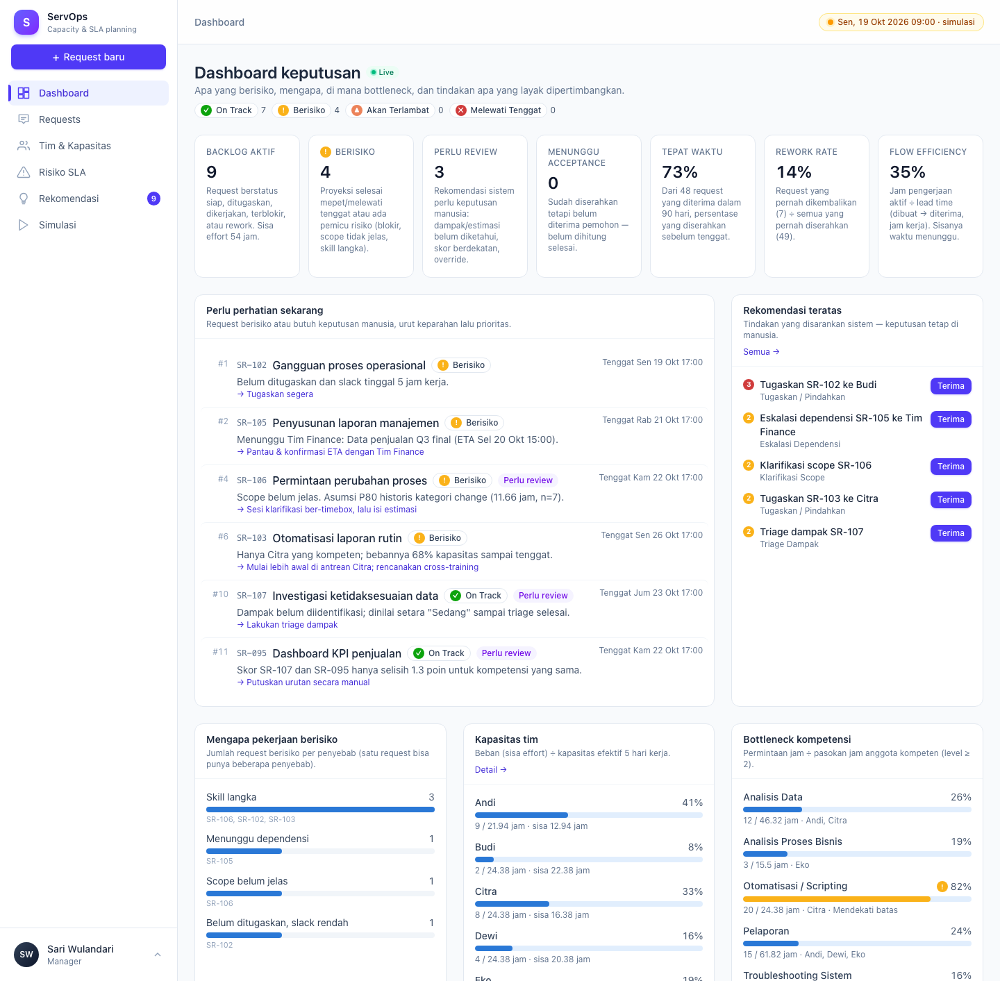

# Intelligent Service Operations & Capacity Planning — Assessment Deliverables

Prototipe **ServOps**: membantu manajemen memutuskan pekerjaan apa yang didahulukan, siapa yang mengerjakan,
kapan pekerjaan berisiko terlambat, dan tindakan apa yang perlu diambil.

| Deliverable | Lokasi |
|---|---|
| **A. Business Analysis** — rumusan masalah, akar penyebab, pertanyaan klarifikasi, asumsi, definisi keberhasilan | [`docs/A-business-analysis.md`](docs/A-business-analysis.md) |
| **B. System Design** — alur proses, model status, struktur data, aturan prioritas, desain kapasitas (as-built) | [`docs/B-system-design.md`](docs/B-system-design.md) |
| **C. Functional Prototype** — aplikasi Laravel 13 + Livewire 4 + MySQL | [`servops/`](servops/) · cara menjalankan & skrip demo: [`servops/README.md`](servops/README.md) |
| Rencana teknis awal | [`BLUEPRINT.md`](BLUEPRINT.md) |
| Screenshot | [`docs/screenshots/`](docs/screenshots/) |

**Mulai cepat:** `cd servops && composer install && npm install && php artisan migrate:fresh --seed && composer run dev`
→ <http://localhost:8000> → login `sari@servops.test` / `password`.

