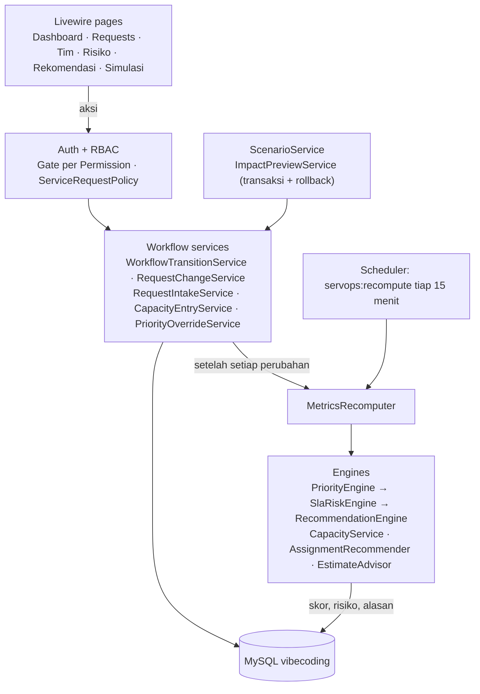
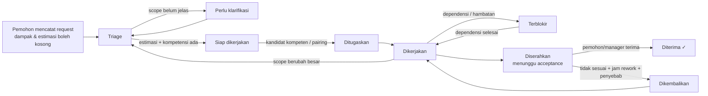
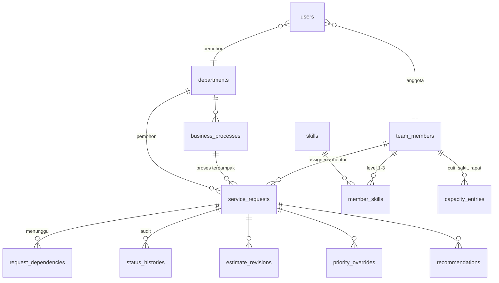

# B. System Design — ServOps (as-built)

> Deliverable B. Menjelaskan desain **sebagaimana diimplementasikan** di prototipe (`servops/`): alur proses, model status,
> struktur data, aturan prioritas, desain kapasitas, prediksi risiko, rekomendasi, perubahan & ketergantungan,
> decision support, RBAC, dan simulasi. Rencana awal ada di [`BLUEPRINT.md`](../BLUEPRINT.md); penyimpangan dicatat di §14.
> Semua bobot & ambang dapat dikonfigurasi di `servops/config/servops.php`.

---

## 1. Arsitektur

| Lapisan | Teknologi / komponen |
|---|---|
| Framework | Laravel 13 · PHP 8.4 · MySQL 9 (database `vibecoding`) |
| UI | Livewire 4 (komponen class-based) · Blade · Tailwind CSS 4 · Alpine.js (bawaan Livewire) |
| Domain | Service layer di `app/Services/*` — engine murni yang diuji terpisah |
| Otorisasi | Session login · enum `Permission` · `ActorRole::permissions()` · `ServiceRequestPolicy` |
| Waktu | `Clock` (waktu simulasi dapat dibekukan/dimajukan) · `WorkingCalendar` (jam kerja, istirahat, libur) |



**Prinsip:** satu-satunya jalan mengubah data adalah lewat service workflow. Setiap operasi → guard → simpan →
catat riwayat → hitung ulang seluruh backlog aktif (prioritas, risiko, rekomendasi). Hasil engine disimpan
ter-denormalisasi di `service_requests` (skor, rincian, risiko, alasan) agar dashboard cepat dan alasan dapat diaudit.

---

## 2. Alur proses



Paralel dengan alur di atas: **recompute** setelah setiap perubahan (dan tiap 15 menit karena waktu berjalan) →
peringkat, risiko, dan rekomendasi selalu mencerminkan kondisi terbaru.

---

## 3. Model status pekerjaan

| Status | Arti | Beban tim? | Waktu tunggu? |
|---|---|---|---|
| Baru | Baru dicatat (otomatis lanjut ke Triage) | – | – |
| Triage | Dinilai dampak, kompetensi, estimasi | – | – |
| Perlu klarifikasi | Scope belum jelas | – | – |
| Siap dikerjakan | Lengkap, belum ditugaskan | ✓ | ✓ |
| Ditugaskan | Ada penanggung jawab, belum mulai | ✓ | ✓ |
| Dikerjakan | Pengerjaan aktif | ✓ | – |
| Terblokir | Menunggu dependensi / hambatan | ✓ | ✓ |
| Diserahkan | Menunggu acceptance — **belum selesai** | – | ✓ |
| Dikembalikan (Rework) | Antre dikerjakan ulang | ✓ | ✓ |
| **Diterima** | Satu-satunya status "selesai" | – | – |
| Dibatalkan | Dihentikan dengan alasan | – | – |

### Guard transisi (ditegakkan `TransitionGuard`)

| Transisi | Ditolak bila |
|---|---|
| Triage → Siap | Estimasi kosong (`ESTIMATE_REQUIRED`) atau kompetensi belum ditentukan |
| → Perlu klarifikasi, → Dibatalkan, Dikerjakan → Triage | Tanpa alasan |
| Siap → Ditugaskan | Anggota tidak aktif / sedang cuti-sakit / di bawah level **kecuali** ada mentor kompeten + alasan override |
| Ditugaskan → Dikerjakan, Terblokir → Dikerjakan | Masih ada dependensi terbuka (peringatan bila melewati batas WIP) |
| Dikerjakan → Terblokir | Tanpa alasan dan tanpa dependensi |
| Diserahkan → Diterima | Pelaku bukan Pemohon / Manager |
| Diserahkan → Dikembalikan | Tanpa alasan, jam rework, atau penyebab rework |

Efek samping penting: masuk Siap → `remaining = estimate`; Dikembalikan → `rework_count++`, sisa effort = jam rework,
estimasi total bertambah, revisi bertipe `rework`; keluar dari status tunggu → akumulasi `wait_hours_total` (jam kerja).

---

## 4. Struktur data



| Tabel | Kolom kunci |
|---|---|
| `service_requests` | `code`, `category`, `requester_priority`, `impact_level` (termasuk *unknown*), `affected_departments/users`, `required_skill_id`, `required_level`, `estimate_hours` (nullable), `remaining_hours`, `actual_hours`, `deadline_at`, `status`, `assignee_id`, `pairing_member_id`, `rework_count`, `rework_cause`, `wait_hours_total`, **hasil engine:** `priority_score`, `priority_breakdown` (JSON), `priority_rank`, `needs_human_review`, `review_reasons`, `risk_level`, `risk_reasons`, `slack_hours`, `latest_start_at`, `projected_finish_at` |
| `team_members` | `daily_hours`, `focus_factor`, `routine_hours_per_day`, `meeting_hours_per_day`, `wip_limit` |
| `request_dependencies` | internal (`depends_on_request_id`) / eksternal (`external_party`), `expected_at`, `resolved_at` |
| `status_histories` | `from_status`, `to_status`, `actor_role`, `actor_name`, `reason`, `meta` (event non-status: estimasi, reassign, dependensi, dampak, override) |
| `estimate_revisions` | `old_hours`, `new_hours`, `delta_pct`, `kind` (initial / revision / rework), `scope_change` |
| `priority_overrides` | `forced_rank`, `pinned`, `reason`, `approved_by`, `revoked_at` |
| `recommendations` | `type`, `severity`, `rationale`, `payload`, `status`, `decided_by`, `fingerprint` (unik — tanpa duplikasi) |
| `scenario_runs` | `scenario`, `params`, `before`, `after` (snapshot) |
| `users` | `role`, `team_member_id`, `department_id` |

---

## 5. Aturan prioritas

```
Skor (0–100) = Σ bobot × nilai faktor (0–100)
```

| Faktor | Bobot | Nilai |
|---|---|---|
| Dampak bisnis | 0.35 | Kritis 100 · Tinggi 75 · Sedang 50 · **Belum diketahui 50** · Rendah 25; + min(20, 5 × dept terdampak); + 5 × (kritikalitas proses − 3) |
| Urgensi waktu | 0.25 | `max(tekanan, kedekatan)` — tekanan = jam dibutuhkan ÷ (jam kerja tersisa × 0.6); kedekatan = 100 × (1 − min(1, jam tersisa ÷ 40)); lewat tenggat = 100 |
| Memblokir pekerjaan lain | 0.15 | 40 × jumlah request terbuka yang menunggu request ini |
| Prioritas pemohon | 0.10 | Tinggi 100 · Sedang 60 · Rendah 30 |
| Kelangkaan kompetensi | 0.10 | 1 orang kompeten = 100 · 2 = 60 · ≥ 3 = 20 |
| Lama menunggu | 0.05 | 10 × hari kerja sejak dicatat |

- **Estimasi kosong** → urgensi memakai **P80 historis kategori** (median/P80 setelah outlier dibuang dengan IQR).
- **Peringkat:** override *pinned* → skor → tenggat → dampak → paling lama.
- **Rincian per faktor** (nilai, bobot, kontribusi, catatan) disimpan dan ditampilkan di detail request.

### Kapan keputusan harus ditinjau manusia

| Kode | Pemicu |
|---|---|
| `IMPACT_UNKNOWN` | Dampak belum diidentifikasi |
| `ESTIMATE_UNKNOWN` | Estimasi kosong (dipakai asumsi P80) |
| `CLOSE_CALL` | Dua request berurutan dengan kompetensi sama berselisih < 3 poin |
| `OVERRIDE_ACTIVE` | Prioritas di-override manajemen |
| `UNDERQUALIFIED_ASSIGNMENT` | Dikerjakan anggota di bawah syarat (dengan pairing) |
| `ESTIMATE_GROWTH` | Estimasi naik > 30% karena scope (revisi rework dikecualikan) |
| `NO_QUALIFIED_MEMBER` | Tidak ada anggota aktif yang memenuhi syarat |

---

## 6. Kapasitas & penugasan

```
kapasitas_efektif(hari) = daily_hours × focus_factor − rutin − rapat − entri kapasitas (cuti/sakit proporsional, rapat khusus)
beban(anggota)          = Σ sisa effort request ditugaskan (siap…rework)
utilisasi               = beban ÷ kapasitas efektif 5 hari kerja (hari ini proporsional terhadap sisa jam kerja)
```

**Penugasan (`AssignmentRecommender`)**
1. **Filter keras:** aktif, tidak cuti/sakit saat ini, level ≥ syarat.
2. **Ranking:** `0.45 × kecukupan kapasitas + 0.25 × selesai sebelum tenggat + 0.15 × kecocokan level (pas = 100, overqualified = 70) + 0.15 × konteks (pengerja sebelumnya)`.
3. Setiap kandidat membawa alasan (level, sisa kapasitas, antrean di depan, perkiraan selesai) dan peringatan (overqualified, utilisasi > 100%).
4. Anggota **di bawah syarat** dengan kapasitas → hanya **opsi pairing** dengan mentor kompeten; tidak pernah otomatis.

**Bottleneck:** permintaan jam per skill ÷ pasokan jam anggota kompeten (level ≥ 2). > 0.8 peringatan, > 1.0 bottleneck.
Skill yang hanya dikuasai satu orang → rekomendasi *cross-training* (single point of failure).

---

## 7. SLA & prediksi keterlambatan

| Besaran | Definisi |
|---|---|
| Tenggat | Komitmen ke pemohon |
| Estimasi | Effort total (direvisi dengan alasan) |
| Sisa effort | Effort yang belum dikerjakan |
| Waktu aktif | Jam pengerjaan tercatat |
| Waktu tunggu | Jam kerja di status siap / ditugaskan / terblokir / diserahkan / dikembalikan (termasuk yang sedang berjalan) |
| Slack | Jam kerja tersisa − sisa effort |
| Mulai paling lambat | Tenggat mundur sebesar sisa effort pada laju kapasitas efektif orang yang mengerjakan |
| **Perkiraan selesai** | Kapasitas harian orang tersebut dipakai untuk antrean berperingkat lebih tinggi, lalu pekerjaan ini; tidak sebelum ETA dependensi. Tanpa assignee → kandidat terbaik |

| Level | Kondisi |
|---|---|
| ✓ On track | Perkiraan selesai ≤ tenggat − buffer (maks(2 jam, 20% sisa effort)) dan tanpa pemicu risiko |
| ! Berisiko | Selesai dalam buffer, **atau** ada pemicu: blokir mendekati batas mulai, ETA dependensi terlambat/tanpa ETA, belum ditugaskan dengan slack < 8 jam, assignee tidak tersedia, scope belum jelas, estimasi membengkak, skill langka, tidak ada kapasitas kompeten |
| ▲ Akan terlambat | Perkiraan selesai > tenggat (atau tidak bisa diproyeksikan) |
| ✕ Melewati tenggat | Waktu sekarang > tenggat dan belum diterima |

Setiap alasan risiko membawa **tindakan yang disarankan** (mis. `EXTERNAL_ETA_LATE` → "Eskalasi ke Tim Finance sekarang; siapkan pekerjaan parsial").

---

## 8. Rekomendasi

| Tipe | Kapan muncul | Saat diterima |
|---|---|---|
| Tugaskan / Pindahkan | Request siap tanpa assignee (kandidat terbaik); assignee tidak tersedia / antrean terlalu panjang dan ada pengganti yang selesai tepat waktu | **Dijalankan** lewat workflow (guard yang sama) |
| Seimbangkan beban | Anggota > 110% sementara anggota kompeten lain < 60%, untuk pekerjaan yang belum dimulai | Dijalankan (reassign) |
| Eskalasi dependensi | Ada dependensi terbuka dan request berisiko / ETA terlambat | Dicatat |
| Klarifikasi scope · Triage dampak | Estimasi kosong · dampak belum diketahui | Dicatat (form triage dampak tersedia di detail) |
| Pairing | Tidak ada anggota kompeten yang bisa tepat waktu, ada anggota di bawah syarat berkapasitas + mentor | Dicatat (keputusan manusia) |
| Negosiasi tenggat · Pecah scope | Akan terlambat tanpa opsi pengganti | Dicatat |
| Cross-training · Tambah kapasitas | Bottleneck skill / single point of failure | Dicatat |

Rekomendasi unik per *fingerprint*; yang kondisinya hilang ditutup otomatis; yang sudah diputuskan manusia tidak dibuka ulang.

---

## 9. Perubahan & ketergantungan

| Perubahan | Aturan | Riwayat |
|---|---|---|
| Revisi estimasi | Wajib alasan; sisa effort bergeser sebesar selisih; > 30% karena scope → review + risiko | `estimate_revisions` + event `estimate_revised` |
| Pekerjaan dikembalikan | Wajib alasan, jam rework, penyebab; tetap request yang sama, kembali jadi beban | Status `Dikembalikan` + revisi `rework` |
| Dependensi | Internal/eksternal + ETA; tidak bisa mulai/lanjut bila terbuka; ETA dapat dijadwal ulang dengan alasan | Event `dependency_added/resolved/rescheduled` |
| Penilaian dampak | Hasil triage (tingkat, dept, pengguna) dengan alasan | Event `impact_assessed` |
| Pindah penugasan | Aturan kompetensi & ketersediaan sama dengan penugasan awal | Event `reassigned` |
| Override prioritas (permintaan mendesak saat tim penuh) | Khusus Manager, wajib alasan, **preview dampak** (transaksi + rollback) sebelum disimpan, dapat dicabut | `priority_overrides` + event `priority_overridden` |

**Pengecualian:** pelanggaran aturan tidak menyebabkan error halaman — ditampilkan sebagai pesan yang menjelaskan
aturan yang dilanggar dan cara memenuhinya.

---

## 10. Decision support (dashboard)

| Indikator | Definisi | Menjawab |
|---|---|---|
| Backlog aktif | Request berstatus siap…rework + total sisa effort | Berapa beban? |
| Berisiko | Request dengan level ≥ Berisiko | Apa yang akan telat? |
| Perlu review | Request dengan pemicu review manusia | Di mana sistem tidak boleh memutuskan sendiri? |
| Menunggu acceptance | Diserahkan, belum diterima | Apa yang belum benar-benar selesai? |
| Tepat waktu | Diterima 90 hari terakhir yang diserahkan ≤ tenggat | Seberapa andal tim? |
| Rework rate | Pernah dikembalikan ÷ pernah diserahkan | Kualitas & kejelasan kebutuhan |
| Flow efficiency | Jam aktif ÷ lead time | Berapa banyak waktu terbuang menunggu? |
| Mengapa berisiko | Distribusi kode alasan risiko | **Mengapa** pekerjaan terlambat |
| Kapasitas tim · Bottleneck kompetensi | Utilisasi per orang · permintaan vs pasokan per skill | **Di mana** bottleneck |
| Hambatan dependensi | Jam menunggu per pihak | Siapa sumber hambatan |
| Akurasi estimasi | Median/P80 per kategori, outlier dibuang, rasio aktual ÷ estimasi | Seberapa bisa dipercaya estimasi |
| Rekomendasi teratas | Rekomendasi terbuka berurut severity | **Apa** yang harus dilakukan |

Dashboard diperbarui otomatis tiap 30 detik saat tab terlihat.

---

## 11. RBAC

| Permission | Manager | Team Lead | Anggota | Pemohon |
|---|:-:|:-:|:-:|:-:|
| Lihat dashboard, tim, risiko, rekomendasi | ✓ | ✓ | ✓ | – |
| Lihat semua request | ✓ | ✓ | ✓ | departemen sendiri |
| Buat request | ✓ | ✓ | ✓ | ✓ (atas nama departemennya) |
| Triage, klarifikasi, batalkan, nilai dampak | ✓ | ✓ | – | – |
| Tugaskan / pindahkan | ✓ | ✓ | – | – |
| Kerjakan (mulai, blokir, serahkan), estimasi, dependensi | ✓ | ✓ | request **sendiri** | – |
| Terima / kembalikan hasil | ✓ | – | – | departemen sendiri |
| Putuskan rekomendasi | ✓ | ✓ | – | – |
| Kelola kapasitas | ✓ semua | ✓ semua | diri sendiri | – |
| Override prioritas | ✓ | – | – | – |
| Simulasi | ✓ (termasuk S5) | ✓ (kecuali S5) | – | – |

Ditegakkan di tiga lapis: middleware route (`can:`), `authorize()` di setiap aksi & `mount()` komponen, dan
penyembunyian kontrol di UI. Audit log mencatat user yang login.

---

## 12. Simulasi

`ScenarioService` menjalankan skenario lewat service workflow yang sama dengan pengguna; setiap run menyimpan
snapshot sebelum/sesudah dan menampilkan diff (KPI, peringkat, risiko, perkiraan selesai, rekomendasi baru/ditutup).

| # | Skenario | Hasil terverifikasi |
|---|---|---|
| S1 | SR-107 ternyata berdampak kritis | Peringkat naik; review & rekomendasi triage hilang |
| S2 | Anggota sakit N hari | `ASSIGNEE_UNAVAILABLE` + rekomendasi pindahkan |
| S3 | Diserahkan lalu dikembalikan | Selesai tetap; rework rate & beban naik |
| S4 | ETA Finance mundur + waktu berjalan | SR-105 berisiko → akan terlambat; eskalasi |
| S5 | Request mendadak dipaksa peringkat 1 | Pekerjaan lain tergeser terlihat (khusus Manager) |
| S6 | Estimasi SR-103 12 → 20 jam | Estimasi membengkak → risiko + review |

**Preview** = transaksi + rollback (termasuk jam simulasi) → tanpa efek samping. **Kontrol jam** +1/+4/+8/+24 jam kerja
dan kembali ke waktu nyata. **Reset** (`migrate:fresh --seed`) hanya bila `SERVOPS_ALLOW_RESET` aktif.

---

## 13. Keputusan desain & konsekuensi

| Keputusan | Keuntungan | Konsekuensi / biaya |
|---|---|---|
| Skor berbobot transparan (bukan ML) | Dapat dijelaskan, diaudit, diuji | Bobot perlu dikalibrasi; tidak belajar otomatis |
| Dampak "belum diketahui" dinilai Sedang + review | Tidak meremehkan risiko tersembunyi | Sementara bisa menaikkan request yang ternyata kecil |
| Urgensi = max(tekanan, kedekatan) | Tenggat dekat selalu terasa mendesak | Satu parameter tambahan (`proximity_horizon_hours`) |
| `Diserahkan` terpisah dari `Diterima` | Rework tidak hilang dari metrik | Bergantung pada acceptance pemohon (tanpa auto-accept) |
| Jam SLA tidak berhenti saat terblokir | Risiko terlihat lebih awal | Breach bisa menyalahkan tim → dimitigasi metrik hambatan per pihak |
| Proyeksi berbasis antrean berperingkat | Deteksi dini sebelum tenggat | Bergantung akurasi sisa effort; asumsi tim mengikuti urutan prioritas |
| Di bawah syarat tidak pernah otomatis | Kualitas terjaga | Kapasitas idle tidak terpakai → ditangani pairing / cross-training |
| Median/P80, outlier dibuang | Tahan durasi ekstrem | Butuh ≥ 5 sampel per kategori (fallback 8 jam) |
| Recompute seluruh backlog di setiap perubahan | Konsisten & sederhana | Tidak skalabel untuk ribuan request (perlu queue + inkremental) |
| Preview via transaksi + rollback | Hasil identik dengan engine sungguhan, nol efek samping | Menjalankan engine dua kali per preview |
| RBAC permission + policy kepemilikan | Akses nyata per peran & kepemilikan | Matriks peran statis di kode (belum ada UI kelola peran) |

---

## 14. Penyimpangan dari blueprint & kualitas

| Rencana (BLUEPRINT) | Implementasi | Alasan |
|---|---|---|
| Recompute via Observers + Job | Dipanggil eksplisit dari service | Hindari loop recompute; deterministik |
| Urgensi = tekanan waktu saja | max(tekanan, kedekatan) | Insiden 2 jam bertenggat hari ini hanya mendapat urgensi ±25 |
| `SCARCE_SKILL` = mulai paling lambat ≤ besok | 1 orang kompeten **dan** bebannya ≥ 60% kapasitas sampai tenggat | Aturan lama salah sasaran |
| Tanpa login, "acting as" | Login + RBAC 4 peran | Permintaan lanjutan |
| Status tunggu tanpa `Dikembalikan` | `Dikembalikan` termasuk waktu tunggu | Antrean rework adalah waktu tunggu |
| Tipe rekomendasi `assign` | Memakai `reassign` dengan payload `action: assign` | Daftar tipe dikunci kontrak blueprint |

**Pengujian:** 229 test otomatis (PHPUnit), termasuk acceptance criteria §14.3 blueprint, semua guard workflow,
setiap engine, matriks RBAC, keenam skenario simulasi, dan halaman Livewire. Format kode: Laravel Pint.

**Belum diimplementasikan:** review `CROSS_DEPT_CONFLICT`, snapshot KPI harian (`kpi_snapshots`) untuk tren & lead time
peringatan, UI kelola peran/pengguna, dark mode.
