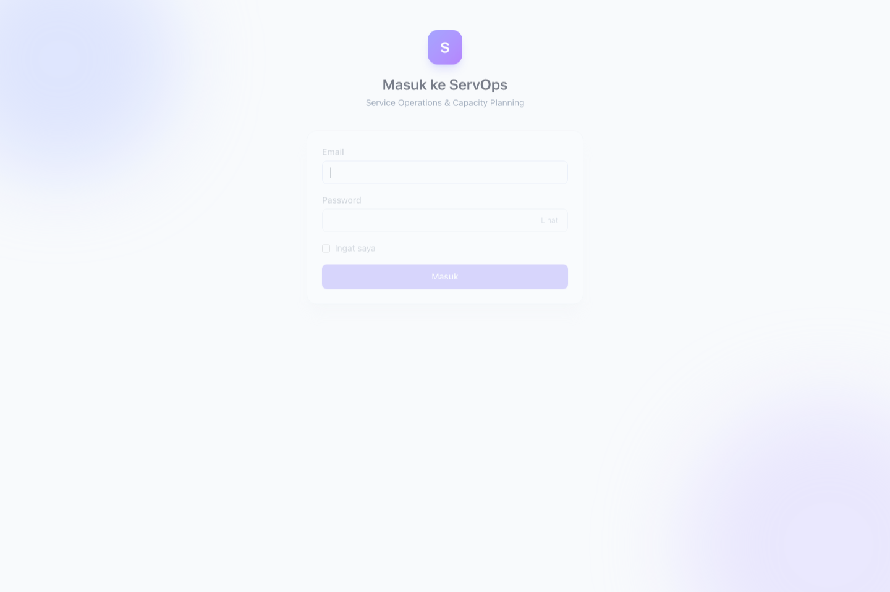
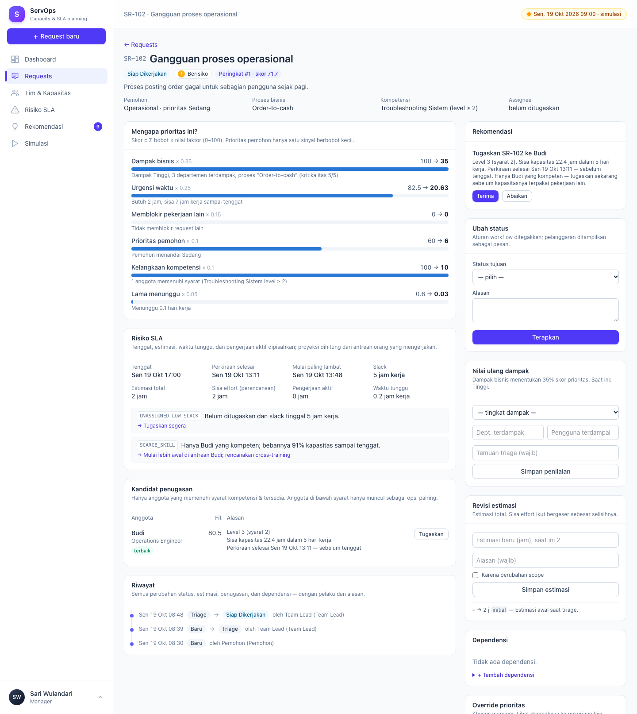
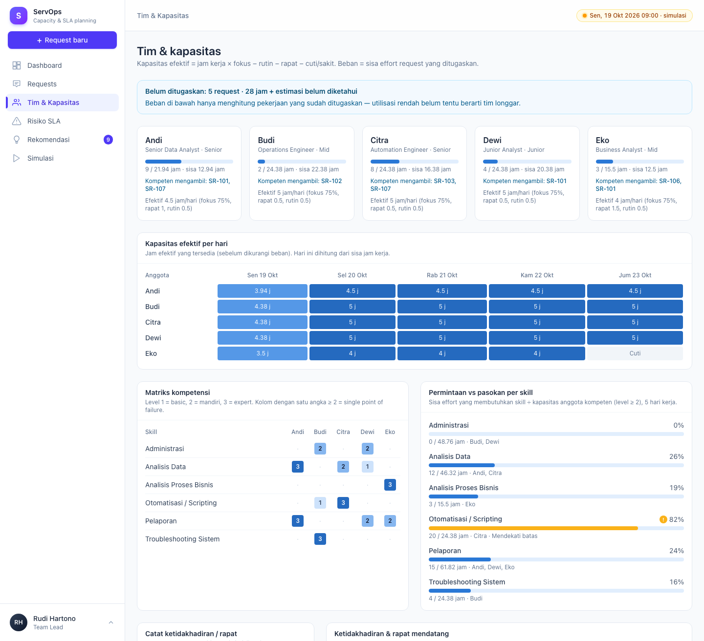
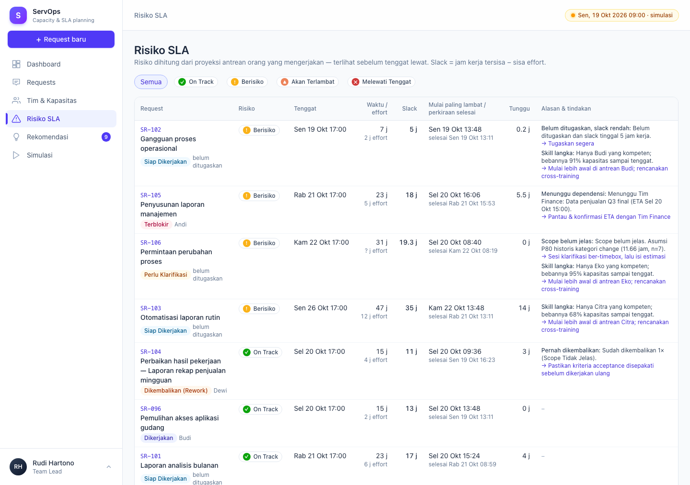
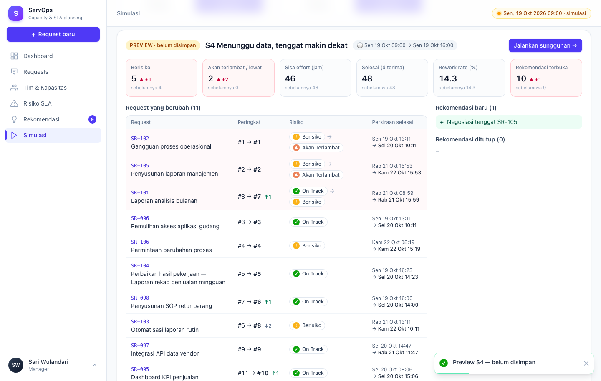

# ServOps — Intelligent Service Operations & Capacity Planning

Prototipe sistem pendukung keputusan untuk tim layanan internal: memprioritaskan service request secara
transparan, menghitung kapasitas tim berbasis kompetensi, mendeteksi risiko SLA **sebelum** tenggat terlewati,
dan memberi rekomendasi tindakan yang dapat dijelaskan — dengan keputusan akhir tetap di manusia.

| Dokumen | Isi |
|---|---|
| [A — Business Analysis](../docs/A-business-analysis.md) | Masalah, akar penyebab, analisis SR-101..107, pertanyaan klarifikasi, asumsi, kriteria keberhasilan |
| [B — System Design](../docs/B-system-design.md) | Arsitektur, alur proses, status, data, aturan prioritas, kapasitas, risiko, RBAC, simulasi (as-built) |
| [Blueprint](../BLUEPRINT.md) | Rencana teknis awal & rumus detail |


---

## Daftar isi

1. [Menjalankan](#1-menjalankan)
2. [Akun demo & hak akses](#2-akun-demo--hak-akses)
3. [Skrip demo 10 menit](#3-skrip-demo-10-menit)
4. [Fitur per halaman](#4-fitur-per-halaman)
5. [Arsitektur singkat](#5-arsitektur-singkat)
6. [Konfigurasi](#6-konfigurasi)
7. [Perintah berguna](#7-perintah-berguna)
8. [Testing](#8-testing)
9. [Keterbatasan](#9-keterbatasan)

---

## 1. Menjalankan

**Prasyarat:** PHP 8.3+ (`pdo_mysql`), Composer 2, Node.js + npm, MySQL di `127.0.0.1:3306`.

```bash
cd servops
composer install && npm install
cp .env.example .env && php artisan key:generate
# isi DB_PASSWORD di .env (DB_DATABASE=vibecoding)

mysql -uroot -p -e "CREATE DATABASE IF NOT EXISTS vibecoding CHARACTER SET utf8mb4 COLLATE utf8mb4_unicode_ci;"
php artisan migrate:fresh --seed     # data soal + tim + 48 data historis + akun demo
composer run dev                     # server + Vite
```

Buka <http://localhost:8000> → login. Seeder **membekukan waktu simulasi** pada momen kerja terdekat
(mis. Senin 19 Okt 2026 09:00) sehingga demo selalu konsisten; waktu dapat dimajukan di halaman Simulasi.

---

## 2. Akun demo & hak akses

Password semua akun: **`password`** (kartu akun juga tampil di halaman login).

| Peran | Akun | Dapat | Tidak dapat |
|---|---|---|---|
| Manager | `sari@servops.test` | Semua — termasuk override prioritas, acceptance, simulasi S5 | – |
| Team Lead | `rudi@servops.test` | Triage, nilai dampak, tugaskan/pindahkan, kerjakan, estimasi, dependensi, putuskan rekomendasi, kelola kapasitas, simulasi | Override, acceptance |
| Anggota | `andi@` `budi@` `citra@` `dewi@` `eko@servops.test` | Lihat semua; kerjakan **request miliknya**; catat ketidakhadiran diri sendiri; buat request | Menugaskan, memutuskan rekomendasi |
| Pemohon | `ops@` `sales@` `finance@` `mgt@servops.test` | Buat request; lihat request **departemennya**; terima/kembalikan hasil departemennya | Dashboard, tim, risiko, rekomendasi |



---

## 3. Skrip demo 10 menit

| # | Login sebagai | Langkah | Yang ditunjukkan |
|---|---|---|---|
| 1 | Sari (Manager) | Buka **Dashboard** | KPI berdefinisi, "Perlu perhatian sekarang" dengan alasan + tindakan, penyebab risiko, bottleneck kompetensi, akurasi estimasi (median/P80 vs rata-rata mentah) |
| 2 | Sari | Buka **SR-102** | Prioritas pemohon "Sedang" tetapi peringkat #1 — rincian skor per faktor menjelaskan mengapa |
| 3 | Rudi (Team Lead) | **Requests → SR-106** → Ubah status → Triage → Siap | Ditolak: "Estimasi belum diketahui" — scope tidak jelas tidak bisa dijadwalkan |
| 4 | Rudi | **SR-107** → Kandidat penugasan | Dewi punya kapasitas tetapi hanya muncul sebagai *opsi pairing* (level 1 < 2) |
| 5 | Rudi | **Rekomendasi** → "Tugaskan SR-102 ke Budi" → Terima & jalankan | Rekomendasi dieksekusi lewat workflow; risiko SR-102 turun; tercatat di riwayat atas nama Rudi |
| 6 | Rudi | **Tim & Kapasitas** → catat Andi sakit 3 hari | SR-095 langsung berisiko "assignee tidak tersedia" + rekomendasi pindahkan |
| 7 | Sari | **SR-107** → Override prioritas → Preview dampak | Request mana yang tergeser — sebelum keputusan disimpan |
| 8 | Sari | **Simulasi** → S4 → Preview → Jalankan | SR-105 berubah Berisiko → Akan terlambat; diff KPI & rekomendasi baru |
| 9 | Sari | **Simulasi** → S3 → Jalankan | Pekerjaan dikembalikan: "Selesai" tidak bertambah, rework rate naik |
| 10 | Bayu (Pemohon OPS) | Login `ops@servops.test` | Hanya menu Requests, hanya request departemen Operasional |

---

## 4. Fitur per halaman

| Halaman | Fitur |
|---|---|
| **Dashboard** `/dashboard` | 7 KPI berdefinisi (angka menghitung naik), perlu perhatian, rekomendasi teratas (terima langsung), penyebab risiko, kapasitas tim, bottleneck kompetensi, hambatan dependensi, akurasi estimasi; auto-refresh 30 detik |
| **Requests** `/requests` | Urut peringkat, filter status/risiko/skill/assignee/perlu review; pemohon hanya melihat departemennya |
| **Request baru** `/requests/create` | Dampak "belum diketahui" & estimasi kosong diperbolehkan → otomatis masuk triage & diberi skor |
| **Detail request** `/requests/{kode}` | Rincian skor, risiko SLA (tenggat, perkiraan selesai, mulai paling lambat, slack, waktu tunggu), kandidat penugasan + pairing, ubah status (field menyesuaikan), pindah penugasan, triage dampak, revisi estimasi, dependensi, override + preview, rekomendasi, timeline audit |
| **Tim & Kapasitas** `/team` | Beban per anggota + request belum ditugaskan yang kompeten diambil, kapasitas efektif per hari, matriks kompetensi, permintaan vs pasokan skill, catat cuti/sakit/rapat |
| **Risiko SLA** `/risk` | Semua request terbuka berurut keparahan & slack, dengan alasan + tindakan |
| **Rekomendasi** `/recommendations` | Terima & jalankan / abaikan dengan catatan; riwayat keputusan (termasuk yang ditutup otomatis) |
| **Simulasi** `/simulation` | Skenario S1–S6 (preview tanpa efek samping / jalankan), kontrol jam, diff sebelum/sesudah, riwayat run, reset |

| | |
|---|---|
|  |  |
|  |  |

---

## 5. Arsitektur singkat

```
Livewire pages ─► Auth + RBAC (Gate per Permission, ServiceRequestPolicy)
                    └─► Workflow services (satu-satunya jalan mengubah data; guard + audit)
                          └─► MetricsRecomputer ─► PriorityEngine → SlaRiskEngine → RecommendationEngine
                                                    (CapacityService · AssignmentRecommender · EstimateAdvisor)
                                └─► MySQL (skor, risiko, alasan disimpan ter-denormalisasi)
Scheduler: servops:recompute tiap 15 menit · Simulasi: ScenarioService (preview = transaksi + rollback)
```

| Folder | Isi |
|---|---|
| `app/Enums` | Status, risiko, dampak, peran + matriks permission, skenario |
| `app/Services/Calendar` | `Clock` (waktu simulasi), `WorkingCalendar` (jam kerja) |
| `app/Services/Workflow` | Transisi + guard, perubahan (estimasi, reassign, dependensi, dampak), intake, riwayat |
| `app/Services/{Priority,Capacity,Assignment,Risk,Estimation,Recommendation,Metrics}` | Engine & orkestrator |
| `app/Services/Simulation` | Skenario S1–S6, kontrol jam, reset |
| `app/Policies` | `ServiceRequestPolicy` |
| `app/Livewire` | Halaman (class-based) |

Detail lengkap: [B — System Design](../docs/B-system-design.md).

---

## 6. Konfigurasi

| `.env` | Default | Keterangan |
|---|---|---|
| `DB_CONNECTION` / `DB_DATABASE` | `mysql` / `vibecoding` | |
| `APP_TIMEZONE` | `Asia/Jakarta` | Jam kerja & SLA bergantung zona waktu |
| `SERVOPS_NOW` | kosong | Kunci "waktu sekarang" (ISO 8601). Kosong = waktu simulasi dari seeder / waktu nyata |
| `SERVOPS_AUTO_RECOMPUTE` | `true` | Hitung ulang setelah setiap perubahan |
| `SERVOPS_DEMO_ACCOUNTS` | `true` | Tampilkan akun demo di halaman login |
| `SERVOPS_ALLOW_RESET` | `true` di `local` | Tombol reset data di halaman Simulasi |

Bobot skor, ambang risiko, jam kerja, dan parameter estimasi: `config/servops.php`.

---

## 7. Perintah berguna

| Perintah | Fungsi |
|---|---|
| `composer run dev` | Server + Vite |
| `php artisan migrate:fresh --seed` | Reset ke data demo (waktu simulasi dibekukan ulang) |
| `php artisan servops:recompute` | Hitung ulang skor, risiko, rekomendasi (juga dijadwalkan tiap 15 menit) |
| `php artisan schedule:work` | Menjalankan scheduler lokal |
| `php artisan test --compact` | Jalankan test |
| `vendor/bin/pint` | Format kode |

---

## 8. Testing

```bash
php artisan test --compact
```

**229 test** (PHPUnit, SQLite in-memory, waktu dikunci agar deterministik), antara lain:

| Area | Contoh |
|---|---|
| Acceptance | `BlueprintAcceptanceTest` — 7 kriteria data soal (SR-102 #1, SR-106 ditolak, SR-107 review, …) |
| Workflow | Semua guard transisi, rework, dependensi, waktu tunggu, audit |
| Engine | Prioritas, kapasitas, penugasan, risiko, estimasi (outlier), rekomendasi (idempoten, ditutup otomatis) |
| RBAC | Matriks akses halaman per peran, kepemilikan request, kapasitas diri sendiri, login & rate limit |
| Simulasi | Keenam skenario, preview tanpa efek samping, kontrol jam, guard reset |
| UI | Semua halaman Livewire & aksi utamanya |

---

## 9. Keterbatasan

- Data tim & historis adalah simulasi; bobot dan ambang perlu dikalibrasi dengan data nyata.
- Proyeksi antrean mengasumsikan tim mengikuti urutan prioritas sistem; request belum ditugaskan diproyeksikan
  ke kandidat terbaik tanpa memperhitungkan request belum-ditugaskan lain yang berebut kandidat sama.
- Recompute menghitung ulang seluruh backlog — cukup untuk prototipe, perlu queue + inkremental untuk skala besar.
- Belum ada: review konflik antar-departemen, tren KPI harian, UI kelola pengguna/peran, dark mode.
- Halaman "Waktu nyata" di simulasi: data seed dibuat relatif terhadap waktu simulasi, sehingga angka risiko
  berubah drastis bila jam dilepas ke waktu nyata.
